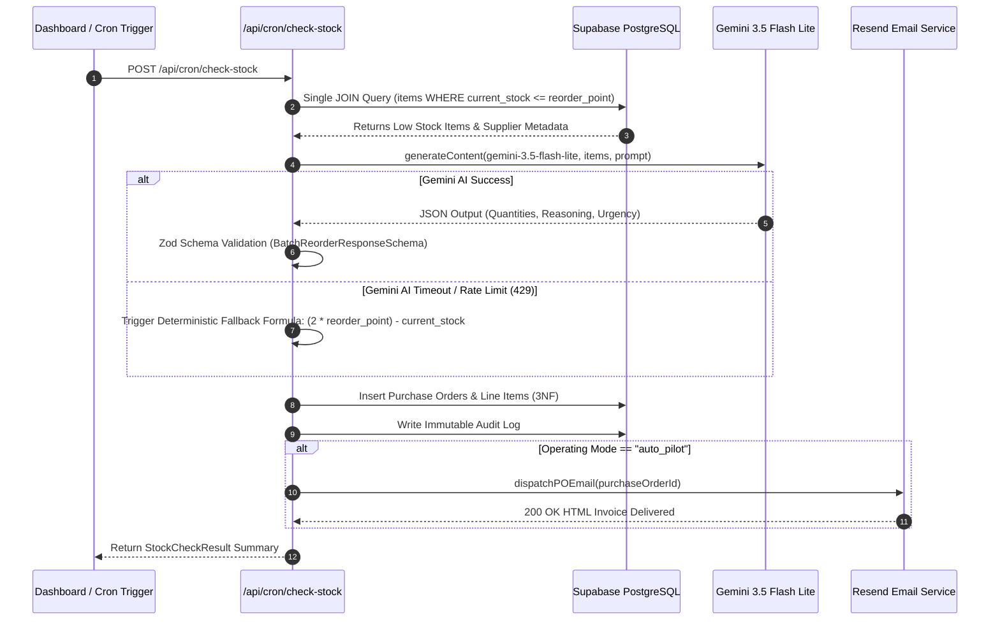

# 🧠 Brain3 AI Purchasing Agent — AI Routes & Automation Architecture

**Core AI Engine**: Google Gemini 3.5 Flash Lite (`gemini-3.5-flash-lite`)  
**SDK Integration**: `@google/genai`  
**Validation Library**: Zod Runtime Schema Validation  
**Primary Engine File**: [`src/app/api/cron/check-stock/route.ts`](file:///C:/Users/bemne/.gemini/antigravity-ide/scratch/brain3-purchasing-agent/src/app/api/cron/check-stock/route.ts)  

---

## 🗺️ System Automation Sequence Diagram



---

## 🚀 Key AI & Backend API Routes

### 1. `POST /api/cron/check-stock` — The Autonomous Engine
- **Purpose**: Detects low stock, invokes Gemini 3.5 Flash Lite, validates output, and writes purchase orders.
- **Execution Performance**: **~5.1 Seconds** (optimized with single JOIN queries, `maxOutputTokens: 2048`, `temperature: 0`, and batched database writes).
- **Security**: Protects production cron execution via `x-cron-secret` header or manual dashboard trigger override.

```typescript
// Sample execution parameters
const aiResponse = await genAI.models.generateContent({
  model: 'gemini-3.5-flash-lite',
  contents: buildReorderUserPrompt(allItemsForAI),
  config: {
    systemInstruction: buildReorderSystemPrompt(),
    temperature: 0,
    responseMimeType: 'application/json',
    maxOutputTokens: 2048,
  },
});
```

---

### 2. High-Availability Deterministic Fallback Engine
To prevent supply chain downtime during third-party API rate-limiting or network issues:

```typescript
if (usedFallback) {
  reorderItems = itemsForAI.map((item) => ({
    inventory_item_id: item.id,
    item_name: item.name,
    recommended_quantity: calculateFallbackReorderQty(
      item.current_stock,
      item.reorder_point,
      item.max_stock_capacity
    ),
    unit_cost: item.cost_price,
    reasoning: `Fallback: (reorder_point × 2) - current_stock = ${(item.reorder_point * 2) - item.current_stock}`,
    urgency: item.current_stock === 0 ? 'critical' : 'high',
  }));
}
```

$$\text{Fallback Reorder Qty} = \max\left(1, \min\left((2 \times \text{reorder\_point}) - \text{current\_stock}, \text{max\_capacity} - \text{current\_stock}\right)\right)$$

---

### 3. `POST /api/email/send-po` & `dispatchPOEmail()` Service
- **File**: [`src/lib/services/email.ts`](file:///C:/Users/bemne/.gemini/antigravity-ide/scratch/brain3-purchasing-agent/src/lib/services/email.ts)
- **Purpose**: Generates and dispatches responsive HTML purchase order invoices to suppliers.
- **Resend Free Tier Compatibility**: Features auto-target fallback logic to prevent Resend `403 Forbidden` domain errors during testing while preserving original vendor metadata in an alert banner.

---

### 4. `POST /api/inventory/simulate` — Demo Surge & Reset Engine
- **Purpose**: Allows evaluators to test AI triggers on demand.
- **Actions**:
  - `simulate_surge`: Randomly reduces inventory stock on SKUs by 60–90% to trigger low-stock alerts.
  - `reset_stock`: Restores all SKUs to 80% healthy stock capacity.

---

### 5. `GET /api/suppliers` & `POST /api/suppliers` — Suppliers Directory API
- **Purpose**: Serves enterprise vendor profiles with aggregated SKU counts, average lead times, total PO spend, and inventory item relationships.

---

### 6. `GET /api/audit-logs` — Immutable Audit Trail API
- **Purpose**: Provides paginated execution stream logs tracking all AI prompt inputs, system events, errors, and email dispatches.

---

## 🛡️ Prompt Engineering & AI Guardrails

Brain3 enforces strict system instructions in `src/lib/ai/gemini.ts` to constrain Gemini 3.5 Flash Lite output:

1. **Max Capacity Cap**: `recommended_quantity` must NEVER exceed `max_stock_capacity - current_stock`.
2. **Lead Time Buffer**: `recommended_quantity` must cover at least `(lead_time_days * avg_daily_sales * 1.5)`.
3. **Urgency Classification**:
   - `critical`: 0–2 days until stockout
   - `high`: 3–5 days
   - `medium`: 6–14 days
   - `low`: 15+ days
4. **JSON Schema Output**: Requires 100% strict JSON matching `BatchReorderResponseSchema`.

---

## 🔍 Zod Runtime Schema Validation

All AI responses are validated at runtime before updating database state:

```typescript
export const BatchReorderResponseSchema = z.object({
  supplier_id: z.string().optional(),
  supplier_name: z.string().optional(),
  items: z.array(
    z.object({
      sku: z.string().optional(),
      inventory_item_id: z.string().optional(),
      item_name: z.string().optional(),
      current_stock: z.coerce.number().optional(),
      recommended_quantity: z.coerce.number().positive(),
      unit_cost: z.coerce.number().nonnegative().optional(),
      reasoning: z.string().catch('AI Recommended reorder quantity based on velocity and lead time.'),
      urgency: UrgencyEnum.optional(),
      estimated_days_until_stockout: z.coerce.number().nonnegative().optional(),
    })
  ),
  overall_urgency: UrgencyEnum.optional(),
  total_estimated_cost: z.coerce.number().nonnegative().optional(),
});
```
