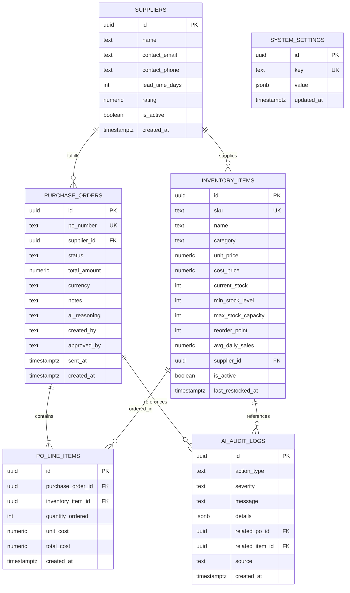

# 🗄️ Brain3 AI Purchasing Agent — PostgreSQL Database Architecture (3NF)

**Database Engine**: PostgreSQL via Supabase  
**Design Normalization**: Third Normal Form (3NF)  
**Schema File**: [`src/lib/supabase/schema.sql`](file:///C:/Users/bemne/.gemini/antigravity-ide/scratch/brain3-purchasing-agent/src/lib/supabase/schema.sql)  

---

## 📐 Entity-Relationship Diagram (Mermaid ERD)



---

## 🏛️ Normalized Table Definitions (3NF Rationale)

### 1. `suppliers` Table
Stores enterprise vendor profiles and fulfillment metrics.
- **`id`** (`UUID PRIMARY KEY DEFAULT gen_random_uuid()`): Unique vendor identifier.
- **`name`** (`TEXT NOT NULL`): Company name (e.g., *FitGear Wholesale*).
- **`contact_email`** (`TEXT NOT NULL`): Purchasing agent communication address.
- **`contact_phone`** (`TEXT`): Direct phone number.
- **`lead_time_days`** (`INTEGER DEFAULT 7`): Expected delivery turnaround window used by Gemini AI.

### 2. `inventory_items` Table
Stores active stock catalog, daily sales velocity, and capacity boundaries.
- **`id`** (`UUID PRIMARY KEY`): Item identifier.
- **`sku`** (`TEXT UNIQUE NOT NULL`): Stock Keeping Unit code.
- **`supplier_id`** (`UUID REFERENCES suppliers(id)`): Foreign Key linking item to its primary supplier (3NF separation).
- **`current_stock`** (`INTEGER NOT NULL`): Live stock quantity on hand.
- **`reorder_point`** (`INTEGER NOT NULL`): Trigger threshold for autonomous purchase orders.
- **`max_stock_capacity`** (`INTEGER NOT NULL`): Hard cap constraint preventing over-ordering.
- **`avg_daily_sales`** (`NUMERIC(8,2)`): Real-time sales velocity metric.

### 3. `purchase_orders` Table
Header table for generated purchase orders.
- **`id`** (`UUID PRIMARY KEY`): Order identifier.
- **`po_number`** (`TEXT UNIQUE NOT NULL`): Human-readable PO number (e.g., `PO-2026-0182`).
- **`supplier_id`** (`UUID REFERENCES suppliers(id)`): Foreign key link.
- **`status`** (`TEXT`): Check constraint: `['draft','pending_approval','approved','sent','acknowledged','cancelled']`.
- **`ai_reasoning`** (`TEXT`): Natural language supply chain explanation generated by Gemini 3.5 Flash Lite.

### 4. `po_line_items` Table (Junction Table)
Fully normalized junction table linking Purchase Orders to Inventory Items.
- **`purchase_order_id`** (`UUID REFERENCES purchase_orders(id) ON DELETE CASCADE`).
- **`inventory_item_id`** (`UUID REFERENCES inventory_items(id)`).
- **`quantity_ordered`** (`INTEGER NOT NULL CHECK (quantity_ordered > 0)`).
- **`unit_cost`** (`NUMERIC(10,2)`): Item unit cost at time of order generation.
- **`total_cost`** (`NUMERIC(12,2)`): `quantity_ordered * unit_cost`.

### 5. `ai_audit_logs` Table
Immutable activity ledger recording every AI prompt, execution decision, and API response.
- **`action_type`**: Enum check constraint: `['stock_check_initiated', 'low_stock_detected', 'reorder_analysis_requested', 'po_generated', 'email_sent', 'ai_error', ...]`.
- **`details`** (`JSONB`): Full structured payload tracking input/output state for auditability.

### 6. `system_settings` Table
Key-value store for global autonomous agent operating parameters.
- **`key`** (`TEXT UNIQUE`): e.g. `'operating_mode'`, `'last_stock_check'`.
- **`value`** (`JSONB`): Operating mode value (`"approval"` vs `"auto_pilot"`).

---

## ⚡ Database Performance Optimization & Indexes

To ensure sub-30ms response times across large datasets, the schema enforces the following indexes:

```sql
CREATE INDEX idx_inventory_items_supplier_id ON public.inventory_items(supplier_id);
CREATE INDEX idx_inventory_items_sku ON public.inventory_items(sku);
CREATE INDEX idx_inventory_items_reorder ON public.inventory_items(current_stock, reorder_point) WHERE is_active = true;
CREATE INDEX idx_purchase_orders_status ON public.purchase_orders(status);
CREATE INDEX idx_purchase_orders_supplier_id ON public.purchase_orders(supplier_id);
CREATE INDEX idx_po_line_items_po_id ON public.po_line_items(purchase_order_id);
CREATE INDEX idx_audit_logs_created_at ON public.ai_audit_logs(created_at DESC);
```

---

## 🔄 Automated Triggers & Constraints

- **`update_updated_at_column()`**: PostgreSQL trigger automatically updating `updated_at` timestamps on row updates.
- **Reorder Threshold Integrity**:
  ```sql
  CONSTRAINT reorder_below_capacity CHECK (reorder_point < max_stock_capacity),
  CONSTRAINT min_below_capacity CHECK (min_stock_level < max_stock_capacity)
  ```
